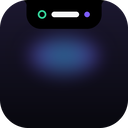
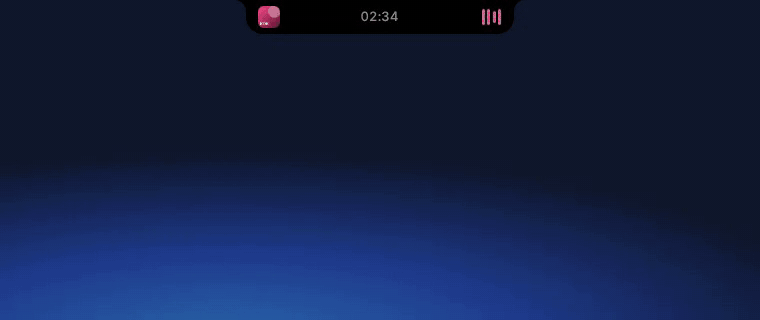
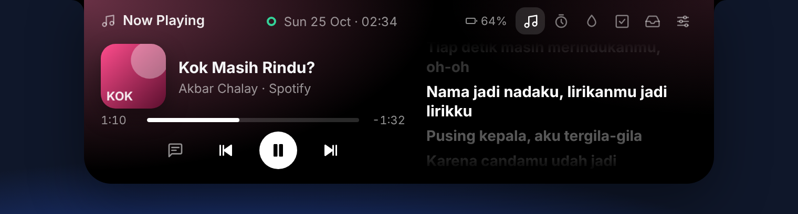
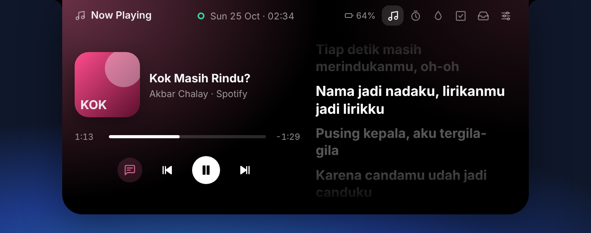
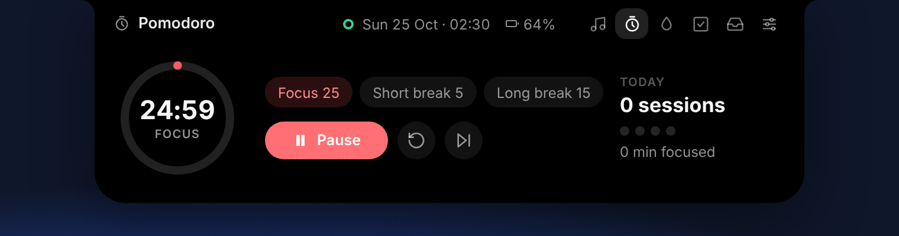
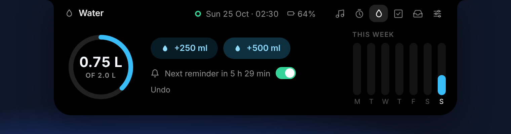
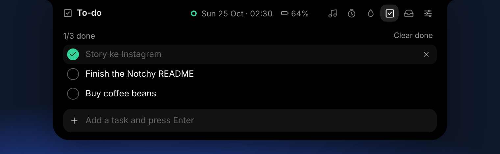
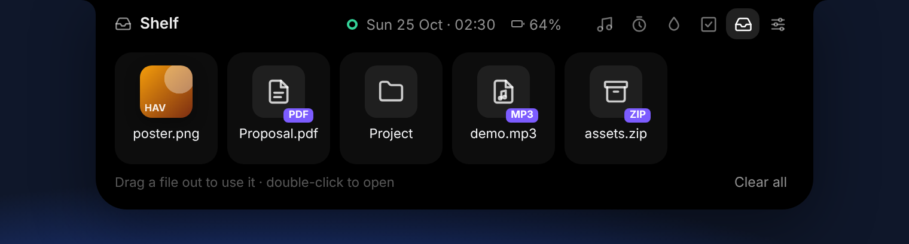
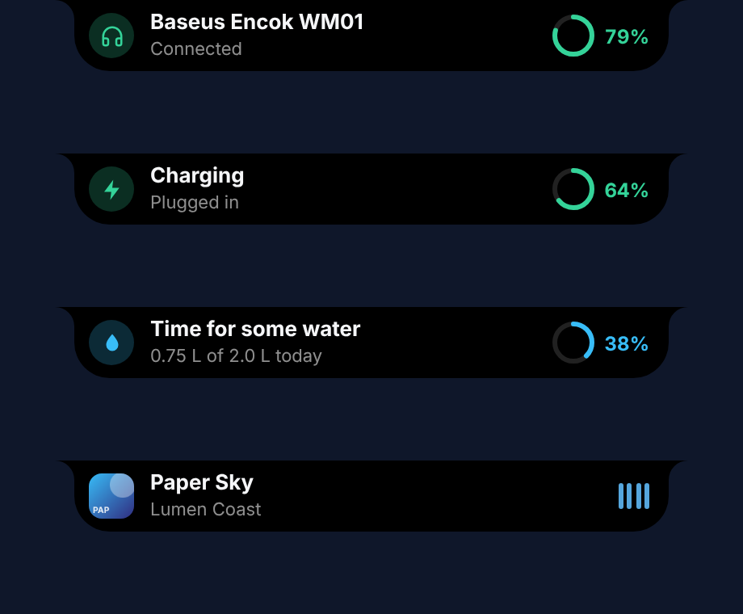

<div align="center">



# Notchy

**A Dynamic Island for Windows.**

Music with synced lyrics, a file shelf, a focus timer, to-dos, water reminders and your headphones' battery — in a small island at the top of your screen.




</div>

---

## What it does

Point at the top-centre of the screen and the island opens. Move away and it folds back into a small pill that shows the time — and whatever matters right now.

| | |
|---|---|
| **Now Playing** | Whatever plays in Spotify, YouTube (Chrome, Edge, Firefox), Apple Music, Media Player, VLC… — cover, progress, play/pause/skip/seek. The card glows with the cover's colour. |
| **Synced lyrics** | Line by line, in time with the song, from [LRCLIB](https://lrclib.net). The lyrics button makes the island taller to show more. |
| **Shelf** | Drag files onto the island to park them. Drag them back out into Explorer, a chat or an editor whenever you need them; double-click opens. |
| **Pomodoro** | Focus 25 / short break 5 / long break 15 (all adjustable), with today's sessions. The countdown sits in the compact island while it runs. |
| **Water** | +250 / +500 ml, a daily goal, a week of history, and a reminder every 45 minutes during the day (8:00–22:00) until the goal is met. |
| **To-do** | A short list: add with Enter, tick, remove. |
| **Live activities** | The island widens for a moment when headphones connect (with their battery), the charger is plugged in or out, the battery runs low, a new song starts, a focus session ends, or it's time to drink. |





<p>




</p>

**The compact island** — the clock in the middle; the song, the focus countdown, or today's water ring and your headphones' battery around it:

  

**Live activities:**



## Install

Every push builds the installers on GitHub Actions — open the latest successful **Build** run under the **Actions** tab and download **Notchy-Windows-…** at the bottom. Tagged versions (`v0.1.0`…) are also published under **Releases**.

- `Notchy-x.y.z-setup.exe` — installs for your account only, no admin prompt.
- `Notchy-x.y.z.msi` — Windows Installer.
- `Notchy-x.y.z-portable.exe` — no install; needs the WebView2 runtime (built into Windows 11 and up-to-date Windows 10).

**Windows will warn you the first time** — the app isn't code-signed yet. On *“Windows protected your PC”*, click **More info → Run anyway**.

## Using it

| What you do | What happens |
|---|---|
| Point at the island | It opens (turn off **Open when you point at it** in Settings to open it with a click instead) |
| Move away | It folds back. After a click inside, it waits a moment longer |
| Click the icons top-right | Switch between Now Playing, Pomodoro, Water, To-do, Shelf and Settings |
| Drag a file onto the island | It opens the shelf and keeps the file there |
| Drag a file off the shelf | A real drag: drop it anywhere that takes files |
| `Esc` | Closes the island |
| Tray icon | Open, Settings, Start with Windows, Quit |

A full-screen game, video or presentation hides the island until it's gone (**Hide over full-screen apps**). With **Always show the island** off, it hides when idle; point at the top-centre of the screen to bring it back.

## Privacy

Everything stays on your computer: settings, to-dos, the water log and the shelf are small JSON files in `%APPDATA%\Notchy`. The shelf keeps paths, never copies of your files. The only network request is to LRCLIB, with the song's title, artist, album and length, to find its lyrics — turn **Synced lyrics** off and there are none. No accounts, no telemetry.

## Build it yourself

You need [Node.js](https://nodejs.org) 22+, [Rust](https://rustup.rs) and the [Tauri prerequisites for Windows](https://tauri.app/start/prerequisites/) (Microsoft C++ Build Tools, WebView2).

```bash
npm install
npm run tauri dev      # run it, with hot reload of the island
npx tauri build        # installers in src-tauri/target/release/bundle/
```

`npm run dev` alone opens the island in a browser at <http://localhost:1420> with a demo backend (a song that plays, a battery, a headset you can connect from the console with `notchyDemo.connectHeadset()`), handy for working on the look.

```bash
npm test                         # island logic (Vitest)
cd src-tauri && cargo test       # Rust
```

## How it works

There is no notch on a PC, so the island is drawn in a borderless, transparent, always-on-top window at the top centre of the primary display. That window never takes focus and lets every click through except over the island itself:

- **Rust** (`src-tauri/src/`) polls the cursor (slower when it's far from the island) and turns click-through on and off around the island's shape, which the page reports as it animates (`island.rs`). It reads now playing from the Windows media controls (`media.rs`), watches Bluetooth devices and the charger (`devices.rs`), takes dropped files from WebView2 and starts native drags out of the shelf (`webview_drop.rs`, `shelf.rs`), and keeps the small JSON documents (`store.rs`).
- **The page** (`src/`) is plain TypeScript, no framework: the island's shape is one SVG path with concave "ears" where it meets the screen edge (`island/shape.ts`), sized by springs (`core/anim.ts`), and opened and closed by a small state machine (`core/fsm.ts`).

The window approach — transparent panel, cursor poll, click-through, WebView2 file drops — comes from [Coucou](https://github.com/Louis-CFM/coucou) (MIT), whose Windows island solved these first; see [THIRD_PARTY_NOTICES.md](THIRD_PARTY_NOTICES.md). The idea of a Dynamic Island for Windows with music, lyrics, a shelf, a focus timer and water reminders was inspired by [Nusa](https://www.tiktok.com/@citoxart/video/7697830443940334869) by Citox.

## License

[MIT](LICENSE)
